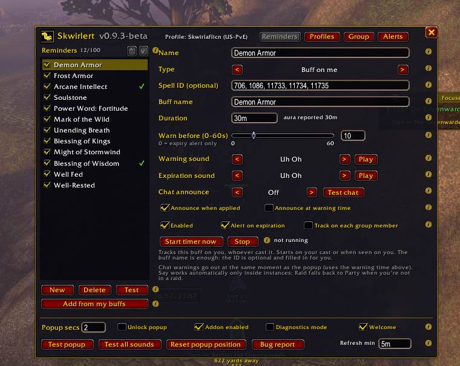

# Skwirlert — Buff & Event Alerts

**Version 0.9.3-beta (beta)** · WoW Forever 1.60.1 · Interface 16001 · Owner: ERitzFoto

Skwirlert warns you before buffs or custom timers run out. You choose what to watch, mostly by clicking buffs that are already on you. Each reminder has its own warning time (0–60 s), warning sound, expiration sound and optional chat announcement. Alerts appear in a movable yellow popup.



*Screenshot: Skwirlert v0.9.3-beta — Reminders settings.*

New in 0.9.3: **A wider, cleaner settings layout** (740 px), clearer title/profile/tabs, wider fields, and smaller, softer help icons. This is a visual update; reminders and alert behavior are unchanged.

New in 0.9.2: **A loaded confirmation at login** and **newer-version notices** learned from guildmates, groupmates and online friends (remembered across sessions).

New in 0.9.1: **Welcome window**, **five-page first-use tutorial**, and **help icons** on the settings tabs.

New in 0.9.0: **Aspect warning** (Aspect of the Cheetah / the Pack when a fight starts, including when a groupmate pulls) and the **after-combat group check** (who needs a Curse, Disease, Poison or Magic removed, and who needs a resurrection, posted once to the group by name). Both are on the new **Alerts** tab and on by default.

New in 0.8.0: **Group Sync** (see groupmates' timers when they run Skwirlert too), **Track on each group member** (e.g. your Arcane Intellect on each party member), **custom timers that need no spell ID**, and **Refresh skips short buffs** such as shouts. See the changelog for the full list.

This is a beta. If something goes wrong, type `/skwirlert report` and include the text in your bug report.

## Installation — Windows and macOS

Skwirlert is designed for **WoW Forever** and requires no additional addons or libraries.

### 1. Download and extract

1. Download the Skwirlert ZIP file.
2. **Windows:** Right-click the ZIP and select **Extract All**. **macOS:** Double-click the ZIP to extract it.
3. Open the extracted folder. For GitHub's **Code → Download ZIP**, open the `Skwirlert-main` folder.
4. Find the **`Skwirlert`** folder containing `Skwirlert.toc`. Copy **that folder**, not the entire `Skwirlert-main` folder.

If you downloaded the packaged player release, the `Skwirlert` folder is already at the top level of the extracted ZIP.

### 2. Copy into your AddOns folder

**Close World of Warcraft completely** before installing or updating. Paste the entire `Skwirlert` folder into your WoW Forever `Interface/AddOns` directory.

**Windows example:**
```text
C:\Program Files (x86)\World of Warcraft\_forever_\Interface\AddOns\
```

**macOS example:**
```text
/Applications/World of Warcraft/_forever_/Interface/AddOns/
```

### 3. Check the folder layout

```text
World of Warcraft/
└── _forever_/
    └── Interface/
        └── AddOns/
            └── Skwirlert/
                ├── Media/
                │   └── SkwirlertIcon.tga
                ├── Sounds/
                │   ├── Uh Oh.mp3
                │   └── ...other sound files
                ├── Core.lua
                ├── Engine.lua
                ├── Config.lua
                ├── ...other addon files
                └── Skwirlert.toc
```

**Correct:** `AddOns/Skwirlert/Skwirlert.toc`

**Incorrect:** `AddOns/Skwirlert-main/Skwirlert/Skwirlert.toc` or `AddOns/Skwirlert/Skwirlert/Skwirlert.toc`.

The `Skwirlert.toc` file must be directly inside the installed `Skwirlert` folder.

### 4. Launch and enable

1. Start WoW Forever.
2. At character selection, open **AddOns** and confirm **Skwirlert** is enabled.
3. Log in and type `/skwirlert` to open settings.

**Updating an existing installation:** Back up your settings, then replace the old `Skwirlert` addon folder with the new one. Restart WoW fully after updating, particularly if sound files changed.

## Loaded message and update notice

* At login, one chat line confirms Skwirlert is loaded and how to open it. Switch it off on the **Group** tab ("Show a Skwirlert loaded line").
* **Newer version notice:** WoW addons can't reach the internet, so Skwirlert compares versions with other players. At login it sends one small hidden message to your guild and whispers it to your online friends (they never see it; Group Sync already shares versions in parties and raids). If a guildmate, groupmate or friend has a **newer** Skwirlert, one of their clients answers once and you get one chat line: `A newer Skwirlert is available: 1.0.0 (you have 0.9.2-beta)`. It only works if someone you play with already has the newer version. Once seen, it's **remembered**: the notice then appears instantly at every login, on every character (even solo), until you install that version.
* Turn it off on the **Group** tab ("Tell me when a newer Skwirlert is around"). It's also silent when Group Sync's Communication is **Off**. `/skwirlert version` shows your version and the newest one seen.

## Welcome window

**First time on a character:** the window opens as a short **tutorial** (five pages: what Skwirlert does, adding your buffs, timers and buffs on others, combat and group alerts, handy controls) with **Back**, **Next** and **Skip tutorial**. It runs by itself only once; reopen it with the window's **Tutorial** button or `/skwirlert tutorial`.

After that, at login a small **Welcome** window opens with your status and buttons: **Refresh my buffs**, **New timer**, **Open settings** and **Tutorial**.

* Tick **Don't show this again** and it won't open for that character any more. Also tick **for all my characters** to hide it everywhere.
* Bring it back with the **Welcome** checkbox at the bottom of the Reminders tab, or open it any time with `/skwirlert welcome`.
* It only opens at a real login (not after `/reload` or a zone change), and never during combat: it waits for the fight to end.
* After an update, characters that hid it get one chat line naming the new version instead.

## Getting started

Nothing is built in: every character starts with an empty list.

1. Get buffed (your own buffs or other players').
2. `/skwirlert` → **Add from my buffs** → click a buff. Its spell ID, name and real duration are filled in, and tracking starts immediately.
3. Adjust the warning time and sounds if you like.

Once added, a buff is always monitored on that profile, whoever casts it on you.

For buffs you put on **someone else** (e.g. Soulstone), or plain timers, click **New** and pick from the menu: **Custom timer (no spell)**, **Buff on me**, **Buff I cast on others**, or **From my recent casts**. You never need to look up a spell ID.

Buffing your party (e.g. Arcane Intellect)? Tick **Track on each group member** on that reminder to get a timer for each person you buffed.

## Minimap button

The squirrel button on the minimap:

* **Left-click:** open or close settings.
* **Shift + left-click:** refresh current buffs (see below) and open settings.
* **Right-click:** Pause Monitoring.
* **Drag:** move it around the minimap.

Hover for a summary: active reminders, whether monitoring is on, pause status, and how many groupmates share timers with you (Group Sync). Position and visibility are saved per profile. If you hide it, `/skwirlert minimap show` brings it back (`/skwirlert minimap reset` puts it back in its default spot).

## Refresh current buffs

`/skwirlert refresh` (or Shift + left-click the minimap button) scans every buff on you right now, including buffs other players cast on you:

* It adds each new timed buff as a reminder. Buffs you already have a reminder for are skipped, even disabled ones, so running it again never creates duplicates.
* It updates running timers from the buffs' real time left.
* Your existing reminders keep all their settings (disabled stays disabled; sounds and warning times are untouched).
* It opens the settings window.
* It respects the 100-reminder limit. Permanent buffs (no timer) and buffs hidden in combat are skipped.
* **Short buffs are skipped** (0.8.0): only buffs lasting **5 minutes or more** are added, so short, constantly recast buffs (shouts and the like) don't flood your alerts. Change it in the settings box **Refresh adds >=** or with `/skwirlert refresh min 2m` (`0` = any length). You can still add a short buff on purpose with **Add from my buffs**.
* **Deleted buffs stay deleted** (0.8.0): if you delete a reminder, Refresh won't add that buff back. `/skwirlert refresh forget` clears that list. (Unticking a reminder also keeps it from being re-added, and keeps its settings.)
* It doesn't resume a pause, and it only scans your own character, not party members.

## Pause Monitoring

Right-click the minimap button or type `/skwirlert pause` to open the Pause dialog:

* **5, 15, 30 or 60 minutes**, or type any number of minutes (default **30**).
* **Pause while grouped:** silent while you're in a party or raid; resumes when you leave the group.
* **Resume now.**

While paused, warning and expiration popups, sounds and automatic chat announcements are silent. Timers keep running and recasts still reset them, but nothing is saved up: an alert that would have happened during the pause is skipped, never shown later. The pause ends on its own when the time is up, and it survives `/reload` and relogging. The minimap tooltip shows the pause status.

## Macros

Paste these into WoW's macro window (`/macro`) to put them on your action bars:

| Macro | What it does |
|---|---|
| `/skwirlert refresh` | Refresh current buffs |
| `/skwirlert pause` | Pause monitoring (opens the dialog; `/skwirlert pause 30` pauses for 30 minutes right away) |
| `/skwirlert resume` | Resume monitoring |

## Info icons

Forgot what a setting does? Hover the small, faint yellow **i** next to it (it brightens when you point at it): every main setting on all four tabs (Reminders, Profiles, Group, Alerts) has one with a short explanation.

## The Reminders tab

**List (left):** up to **100 reminders per profile**, scrollable with the mouse wheel or `^` / `v`.

* **Checkbox:** monitoring on or off.
* **Status icon:**
  * Green check: running, with the time read from the actual buff.
  * Yellow check: running on an estimate (the buff isn't readable right now, e.g. in combat).
  * X: a custom/manual timer is running.
  * No icon: not running.
* Hover a row for details.

**New** opens a small menu (0.8.0):

* **Custom timer (no spell):** just a name, a duration and Start (or a macro: `/skwirlert start <name>`). No spell ID needed. Optionally name a spell to start it automatically when you cast it.
* **Buff on me** / **Buff I cast on others:** type the buff's name. When it's a spell your character knows, the spell ID is filled in for you. The ID is optional anyway: matching by name works, and the ID is learned on your first cast.
* **From my recent casts:** lists the spells you cast this session and on whom. Click one to add it with its name, ID and real duration filled in. A spell cast on someone else becomes "Buff I cast on others".

A buff reminder with no name and no ID shows a red note: it can only be started by hand.

**Add from my buffs:** lists the buffs on you now (icon, ID, duration, time left). Buffs you already track are marked; permanent buffs can't be added.

**Editor (right):**

* Name and type:
  * **Buff on me:** a buff on you, whoever cast it.
  * **Buff I cast on others:** e.g. Soulstone; remembers who got it.
  * **Custom timer (no spell needed):** starts with Start, `/skwirlert start <name>`, or (optional) when you cast a named spell.
* **Buff name** and **Spell ID (optional)** (a name alone is enough), and duration. Durations are shown and typed like `30s`, `10m`, `30m30s` or `1h` (a plain number means seconds; `10:00` also works). The real duration is learned from the buff.
* **Warn before (0–60 s):** a slider and number box that stay in sync. **0 = expiration alert only**: no warning popup, sound or chat message.
* Warning sound and expiration sound (six bundled sounds, two WoW sounds, or silent), each with a **Play** button.
* **Chat announce:** Off / Say / Party / Raid / Group (auto), with "when applied" and "at warning time" options.
* Enabled, Alert on expiration, **Track on each group member** (see below), Start timer now / Stop.

### Track on each group member (0.8.0)

For buffs you also cast on groupmates, such as a mage's **Arcane Intellect**. Tick **Track on each group member** on that reminder, and every member who has **your** copy gets their own timer:

* Each person's timer follows their own copy. If you die and rebuff only yourself, your timer restarts and theirs keep their own times.
* **Merged alerts:** warnings that come due together become one popup and one sound, e.g. `Arcane Intellect expires in 30s: Bob, Ann`.
* **They die:** `Arcane Intellect has ended: Bob (died)`. Rebuff them and their timer starts fresh.
* Another player's copy replaced yours, or they left the group: their timer is dropped silently (no false alarm).
* **Out of range / hidden:** the estimate from your cast keeps running, marked `(est.)`. If that player runs Skwirlert and tracks the same buff, the exact time they read is shared through Group Sync and corrects your estimate.
* It works even if your groupmates don't run Skwirlert. Only copies **you** cast are counted.
* Off by default. The first time you cast a tracked buff on a groupmate, Skwirlert prints a one-line tip pointing to the option.

**Bottom row:** popup seconds, unlock popup, addon enabled, **Diagnostics mode**, **Welcome** (show the welcome window at login), **Refresh min**, test popup, test all sounds, reset popup position, **Bug report**.

## Profiles tab

Works like the profile page of most addons:

* **Each character gets its own profile automatically**, named like **"Skwirlaflicn (US-PvE)"** (character name plus region and ruleset), and saved on logout. The header shows which profile is active.
  * Forever is realmless, so the game's long server name (e.g. "CAMWOW US2 Realm 1 PvE") is shortened to region and ruleset. The full server name is still shown on the Profiles tab and in bug reports. If a server name doesn't fit that pattern, it's shown in full.
  * Characters are tracked by their unique character ID, not their name, so two characters with the same first name never share a profile by accident (the second gets "… 2").
* **Rename:** type a name in the profile name box and click **Rename** to rename the selected profile (not Default). Characters using it follow the rename.
* **Default** is always there and always starts empty.
* **Use this profile:** switch to any profile, e.g. your main's. Several characters can share one; changes then apply to all of them.
* **Copy into current profile:** overwrite your current profile with a copy of another (click twice to confirm).
* **Delete profile:** click twice. You can't delete Default or the profile you're using. A character whose profile is deleted gets its own fresh profile at its next login.
* **New empty profile** and **Reset current profile** (empties it; click twice).
* Running timers belong to the character, not the profile, so sharing a profile never mixes up timers.
* Commands: `/skwirlert profile`, `profile list`, `profile use <name>`, `profile rename <new name>`.

### Share a profile (export / import)

* **Export current profile** produces a code like `SKW1:…`. Press Ctrl+C and send it through Discord, email and so on (in-game chat is too short for most codes).
* To import, paste the code, optionally type a name, and click **Import**. It becomes a **new** profile and Skwirlert switches to it; no existing profile is overwritten.
* Codes are data only, never run as code. Everything is checked on import: damaged or incomplete codes are rejected (checksum), names are cleaned, values are clamped, unknown sounds are replaced, and the 100-reminder cap applies.

## Group tab: Group Sync (0.8.0)

Players in the same party or raid who all run Skwirlert can see each other's **running timers**: buff name, time left, whether it was read from the buff or estimated, and who it's on (e.g. a Soulstone or your Arcane Intellect on Bob). Nothing else is shared. Messages go through WoW's hidden addon channel; players never see them in chat.

* **Communication:** **Share and receive** (default), **Receive only** (see others, send nothing), or **Off** (send nothing, ignore everything).
* **Frequency:** how often your updates may go out. **Low (recommended)** = at most one update every 15 seconds; Normal = 8 s; High = 4 s. Updates are only sent when something **changes** (a timer starts, refreshes or ends, or someone joins). There is no polling and no "heartbeat": in a steady group Skwirlert sends nothing at all. Other players' clients count your timers down themselves.
* **Don't send during combat** (default on): updates wait until combat ends, so nothing is sent mid-fight.
* During boss encounters the game blocks addon messages; Skwirlert just sends after the fight.
* The tab lists each groupmate's timers live. The minimap tooltip shows how many groupmates share timers.
* `/skwirlert group` shows the settings and what's shared; `/skwirlert group share | receive | off` changes the mode.

## Alerts tab: combat alerts (0.9.0)

Both alerts need no setup and are on by default for every character.

### Aspect warning

Aspect of the Cheetah and Aspect of the Pack daze you when you're hit. Aspects don't run out, so they aren't countdown reminders; instead Skwirlert warns when a fight starts:

* **Hunter, Cheetah on:** when you enter combat: `Aspect of the Cheetah is on - you'll be dazed when hit!`
* **Hunter, Pack on:** when you **or any group member** enters combat: `Aspect of the Pack is on - Bob is in combat!` (Pack dazes the whole party).
* **Any class, Pack on you** (a hunter's Pack shows as a buff on everyone near them): `Aspect of the Pack is on you - Bob is in combat!`, so you know even if you never noticed the buff. This works on **your** Skwirlert alone: the hunter doesn't need to run Skwirlert, and it's on unless you turn it off.
* **Tell the group** (hunter, off by default): also post one line to Party / Raid / Group, for groupmates who don't run Skwirlert.
* At most one aspect alert per fight. Own sound (default: mechanical alert) and a Test button.

### After-combat group check

A few seconds after combat ends (3 s by default, so healers can act first), Skwirlert checks everyone in your group:

* **Curse** and **Disease** (on by default), **Poison** and **Magic** (off by default), and anyone **dead**.
* One popup for you, and one message to the group (default **Group (auto)**), by name:
  `Bob needs a Curse removed (Curse of Agony). Ann is dead - needs a resurrection. Can help: Curse - Me; Resurrect - Cy.`
* **"Can help"** lists only players whose Skwirlert found a fitting spell in **their own spellbook** (you, plus groupmates via Group Sync). It never guesses from someone's class. The tab shows what your character can fix.
* **No spam:** only one Skwirlert in the group posts (the others hear it over Group Sync and stay quiet); each person and problem is announced at most once a minute; debuffs about to wear off are skipped; a new pull during the wait postpones the check until that fight ends; nothing while paused.
* Solo, you only get a popup (for yourself).
* **Check now** / **Check and announce** buttons, `/skwirlert check` and `/skwirlert check announce`. Choose **Off (popup only)** to keep it out of chat.

## Chat announcements

The warning message goes out at the same moment as the popup, so it uses that reminder's warning time.

* **Party:** sent when grouped.
* **Raid:** falls back to Party when you're not in a raid.
* **Group (auto):** raid, party or instance chat, whichever applies.
* **Say:** sent automatically only inside instances; outside, the game only allows Say from a click, so **Test chat** works anywhere.

Hidden player names are never sent. `/skwirlert chatlog` shows sent, skipped and failed messages.

## Something went wrong? (bug reports)

* **Errors are always captured** (no setup needed). Any Lua error inside Skwirlert is caught with where it happened, a stack trace and the game state. You get one chat line, and the error goes to WoW's error popup or BugSack once. Up to 25 errors are kept across reloads.
* **Diagnostics mode** (checkbox, or `/skwirlert diag on`) additionally records an activity log (casts, timers, alerts, sounds, chat). It's off by default to save memory: turn it on, reproduce the problem, then make a report. Turning it off clears the log.
* **Bug report** (button, or `/skwirlert report`) opens a copy box with everything: versions, client build, profile, reminders, missing APIs, sound settings, errors with stack traces, and the activity log. Press Ctrl+A, then Ctrl+C, and paste it into your ticket or message.
* `/skwirlert errors` lists captured errors; `/skwirlert errors clear` clears them.
* **No game sound?** `/skwirlert soundcheck` shows your sound settings (read-only) and plays a test sound. **Ctrl+S** is WoW's toggle for all sound. Skwirlert never changes sound settings.

## Commands

| Command | Purpose |
|---|---|
| `/skwirlert` | Open/close settings |
| `/skwirlert refresh` | Add every timed buff on you now (no duplicates; skips short and deleted buffs), refresh timers, open settings |
| `/skwirlert refresh min <duration>` | Refresh only adds buffs at least this long (default `5m`; `0` = any) |
| `/skwirlert refresh forget` | Let Refresh add buffs you deleted before |
| `/skwirlert group [share / receive / off]` | Group Sync settings and what groupmates share |
| `/skwirlert check [announce]` | Run the after-combat group check now (locally, or post it) |
| `/skwirlert aspect` | Aspect warning status |
| `/skwirlert welcome` | Open the welcome window |
| `/skwirlert tutorial` | The short how-it-works tutorial |
| `/skwirlert version` | Your version and the newest version seen via guild, group or online friends |
| `/skwirlert pause [minutes / group]` | Pause dialog, or pause now (e.g. `pause 30`) or while grouped (`pause group`) |
| `/skwirlert resume` | Resume monitoring now |
| `/skwirlert minimap [show / hide / reset]` | Minimap button |
| `/skwirlert test [1-6 or name]` | Test popup + every sound (or one) |
| `/skwirlert status` | What's running, time left, verified or estimated |
| `/skwirlert buffs` | Buffs on you with spell IDs and durations |
| `/skwirlert casts` | Your recent casts with spell IDs |
| `/skwirlert aura <id or name>` | Is this buff on you, and readable? |
| `/skwirlert new <name>` | Create a reminder |
| `/skwirlert start <name>` / `stop <name>` | Manual timers |
| `/skwirlert profile [list / use <name> / rename <new>]` | Profiles |
| `/skwirlert report` | Copyable bug report |
| `/skwirlert diag on/off` | Diagnostics mode |
| `/skwirlert errors [clear]` | Captured errors |
| `/skwirlert soundcheck` | Sound settings + test sound |
| `/skwirlert soundlog` / `chatlog` | Recent sound / chat results |
| `/skwirlert channel [Master/SFX/...]` | Sound channel (default Master) |
| `/skwirlert api` | API probe |
| `/skwirlert debug` | Print debug messages in chat |
| `/skwirlert unlock` / `lock` / `resetpos` | Move the popup |
| `/skwirlert reset confirm` | Empty the current profile |

## Upgrading from 0.9.2

This release updates the settings window layout only: it is wider (740 px), the title, profile and tabs have more room, the form fields and hints are less crowded, and the yellow help icons are smaller and fade until hovered. Existing reminders, profiles, settings and timers are preserved. No alerting behavior changed.

## Upgrading from 0.9.1

Install over the old folder; nothing is reset. The "loaded" line and the newer-version notice are on by default (Group tab to turn them off).

## Upgrading from 0.9.0

Install over the old folder; nothing is reset. The welcome window opens at your next login (it also shows what's new); tick **Don't show this again** if you don't want it. Characters that already have reminders skip the tutorial (it's still available from the window or `/skwirlert tutorial`).

## Upgrading from 0.8.0

Install over the old folder; nothing is reset. The Alerts tab's settings are added with their defaults (both alerts on; group check posts to Group (auto); hunters' "Tell the group" off). Groupmates on 0.8.0 still sync timers with you; they just don't take part in the "only one posts" agreement.

## Upgrading from 0.7.0

Install over the old folder; your profiles, reminders and settings are kept. New settings get their defaults: Group Sync **Share and receive**, frequency **Low**, **Don't send during combat** on; Refresh minimum **5m**; **Track on each group member** off on every reminder. Reminders that Refresh added before (e.g. a short shout) stay in your list; untick or delete them if you don't want them, and Refresh won't add them back.

## Upgrading from 0.5.0

Your profile "Name - CAMWOW US2 Realm 1 PvE" is renamed to "Name (US-PvE)" and linked to your character ID the first time each character logs in. Nothing is lost, and characters sharing a profile keep sharing it.

## Upgrading from 0.1–0.4

Your existing reminders and settings move into the profile of **the first character you log in with**, and chat tells you which profile that is. Other characters start empty and can **Use** or **Copy** that profile from the Profiles tab. The former built-in reminders (Demon Armor, etc.) become normal reminders you can keep or delete.

## Sounds

Six alert sounds supplied by ERitzFoto are included (`Sounds/`), plus two built-in WoW sounds and "silent". Sounds play on the Master channel by default (`/skwirlert channel` to change). If a sound file can't be played, Skwirlert plays a Blizzard sound instead and logs it (`/skwirlert soundlog`). After adding or replacing sound files, restart WoW fully.

## Release status and compatibility

**v0.9.3-beta is a testing build**, not a stable 1.0 release. Earlier core reminder/sound features have been exercised in WoW Forever, but newer combat, group, welcome and version-messaging features still need full in-game validation. The supplied mock WoW client test report records **638 passing checks and 0 failures**; mock tests are not a substitute for live validation.

This is an **alert addon**, not a buff-management or auto-rebuff addon. Shaman totem reminders are planned for a later release pending Forever API testing.

## Credits and licence

Skwirlert's original code is released under the **MIT License** (`LICENSE.txt`). Icon, sound and artwork credits are in `CREDITS.md`. Changes by version are in `CHANGELOG.md`.

## Attribution


All code was written independently for this project. No third-party code or libraries are included. BuffReminder, AuraCue, Shalu Sound Alerts and Buffy were studied for behavior only, and AceDB-style addons for how a profiles page usually works.
